<picture>
  <source media="(prefers-color-scheme: dark)" srcset="docs/vitrine/capa-escuro.svg">
  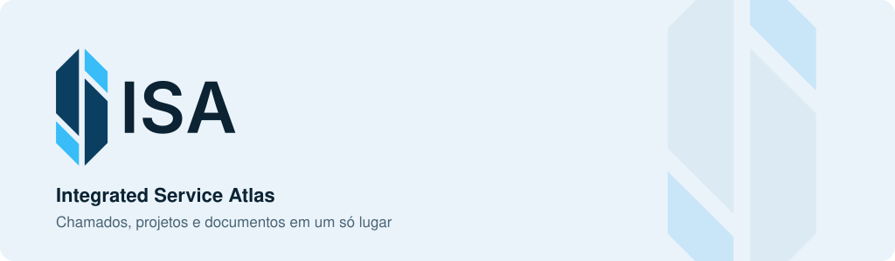
</picture>

Uma plataforma de atendimento que também cuida dos projetos e dos documentos da equipe. O chamado chega, é triado, ganha prazo e responsável, vira tarefa quando precisa e deixa registro do começo ao fim.

<p align="center">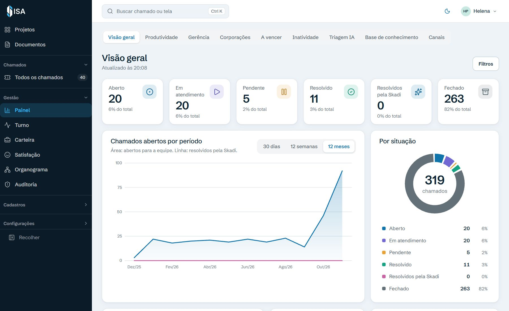</p>

> **English:** ISA is a self-hosted platform that brings a service desk (SLA, routing, AI triage), project management (boards, sprints, time tracking) and a real-time block editor for team documents into one app. React + TypeScript on the front, Express + Prisma + PostgreSQL on the back. The interface and docs are in Brazilian Portuguese.

O nome vem da runa nórdica do gelo, **ᛁ** (*isa*): um único traço, firme e direto. O símbolo une duas metades que desenham a runa, e o vão entre elas forma um S.

## O que faz

| Área | Destaques |
|---|---|
| **Chamados** | Filas, SLA por plano em horário comercial, roteamento e escalonamento automáticos, chat em tempo real, pesquisa de satisfação, portal do cliente |
| **Projetos** | Quadro, lista, calendário, linha do tempo, sprints, dependências, apontamento de horas, automações, dossiê exportável, vínculo de tarefa com chamado |
| **Documentos** | Espaços e páginas aninhadas, editor de blocos com menu `/` e atalhos de Markdown, edição simultânea, histórico, lixeira, importar e exportar `.md` |
| **Skadi, a assistente** | Triagem com grau de confiança, checklist de abertura, orientação ao usuário, base de conhecimento com busca semântica |
| **Gestão** | Turno, carteira de clientes, painéis, organograma, auditoria de tudo o que muda |
| **Integrações** | API pública com chaves por escopo, webhooks assinados, servidor MCP, Microsoft Teams, e-mail de entrada e saída |

## Uma tela para cada papel

A equipe usa o mesmo menu lateral; o cliente tem um portal simples, sem menu. O que muda é a tela inicial, pensada para a pergunta de cada papel.

| Papel | Abre em | Responde |
|---|---|---|
| Cliente | Início | O que depende de mim e quando volta? |
| Analista | Meus chamados | Qual é o próximo? |
| Ticket Manager | Turno | O que vai estourar e quem está livre? |
| Gerente | Carteira | Cumprimos? Quem está em risco? Por quê? |
| Administrador | Painel | Como está a operação? |
| Projetos | Minha semana | O que entrego e o que está travado? |

<table>
  <tr>
    <td width="50%">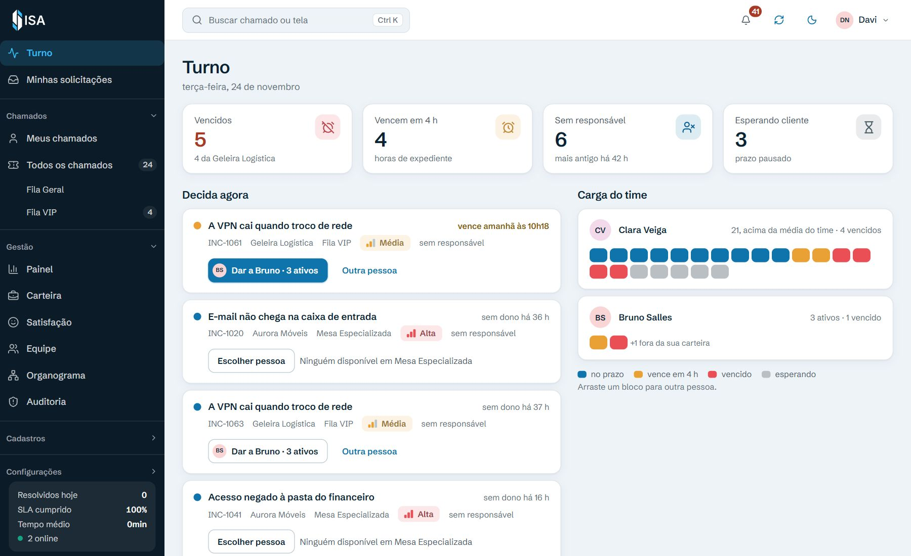<br><sub>Turno: a decisão na própria linha</sub></td>
    <td width="50%">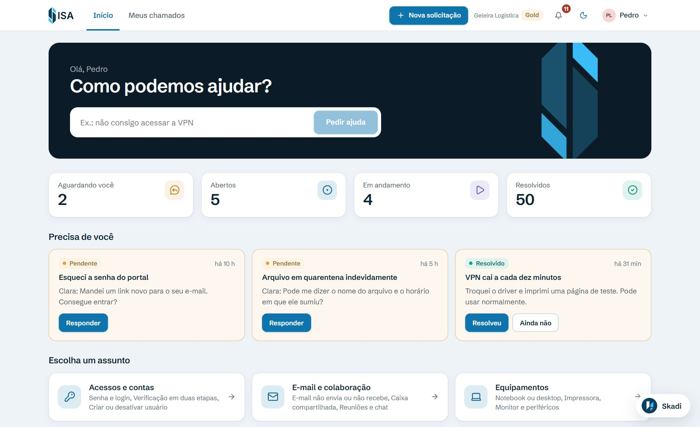<br><sub>Início do cliente: assuntos em cartões e o andamento de cada chamado</sub></td>
  </tr>
  <tr>
    <td>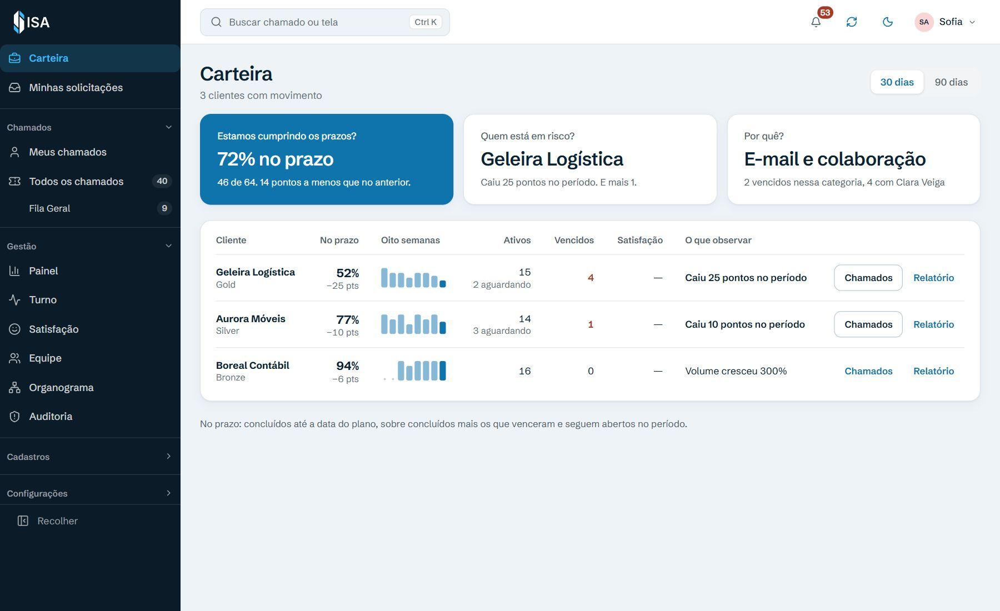<br><sub>Carteira: três respostas antes da reunião</sub></td>
    <td>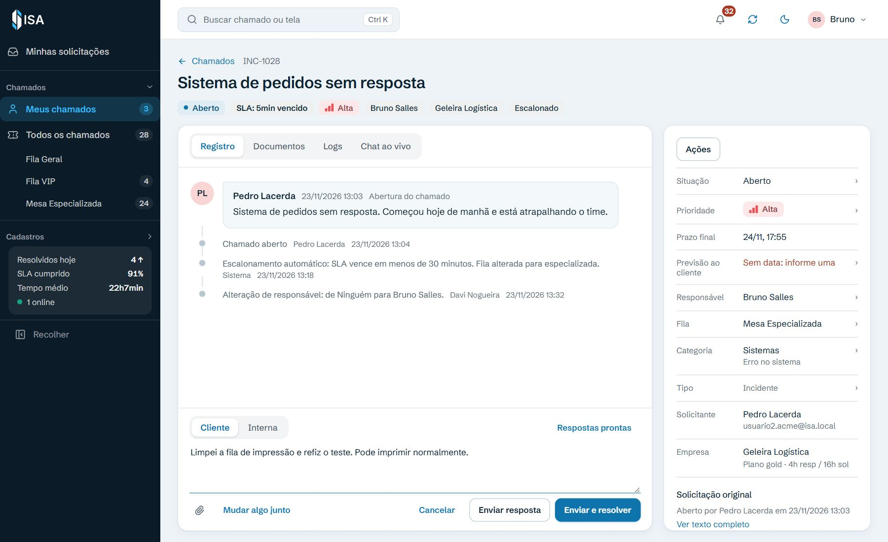<br><sub>Chamado: conversa, dados e "Enviar e resolver"</sub></td>
  </tr>
  <tr>
    <td>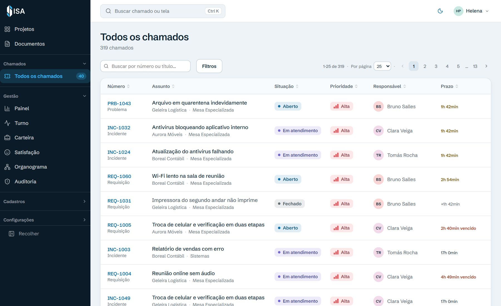<br><sub>Lista em colunas, com situação, prioridade e prazo</sub></td>
    <td>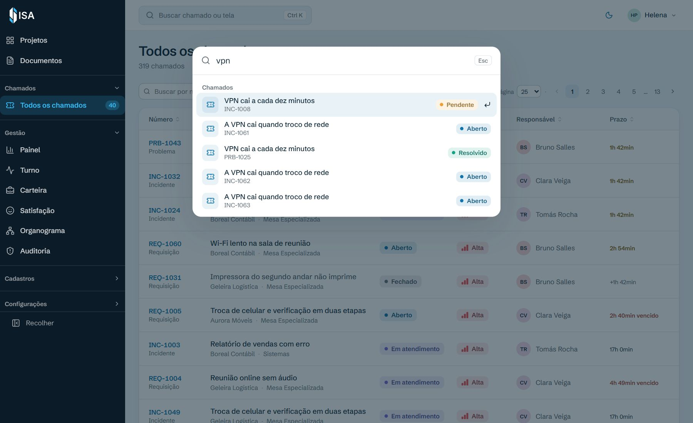<br><sub>Ctrl K: telas, ajustes e chamados</sub></td>
  </tr>
</table>

## Também

<table>
  <tr>
    <td width="50%">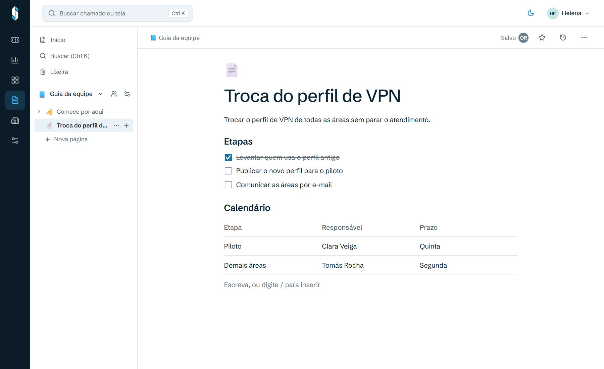<br><sub>Documentos: duas pessoas na mesma página</sub></td>
    <td width="50%">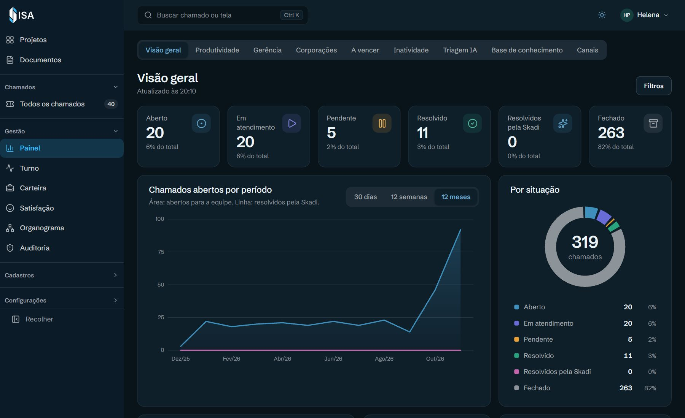<br><sub>Painel gerencial no tema escuro</sub></td>
  </tr>
  <tr>
    <td>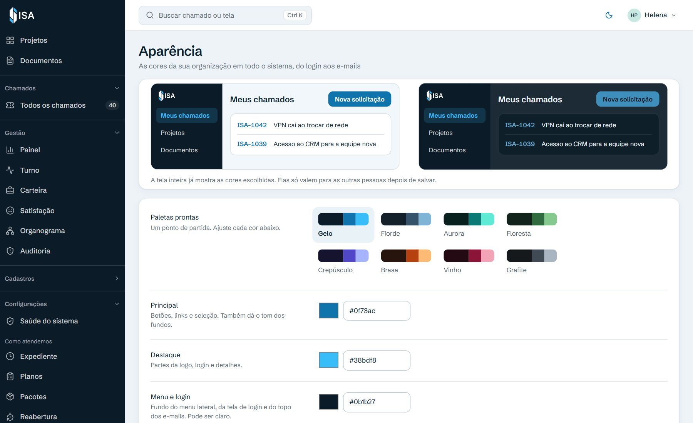<br><sub>Três cores mudam o sistema inteiro</sub></td>
    <td>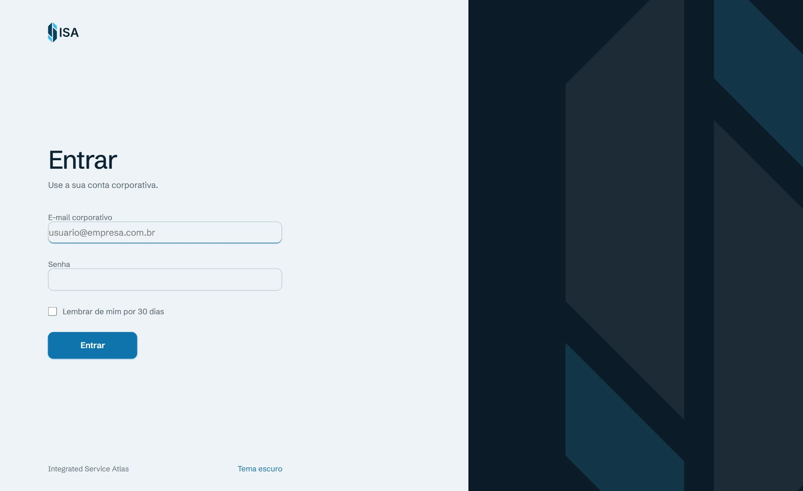<br><sub>Login</sub></td>
  </tr>
</table>

## Decisões que valem a leitura

- **Cores da organização em três valores.** O admin escolhe principal, destaque e a do menu e login; [`brandTheme.ts`](frontend/src/lib/brandTheme.ts) deriva mais de 50 tokens para claro e escuro e corrige cada texto até passar o contraste AA. Os [testes](frontend/src/lib/brandTheme.test.ts) cobrem cores extremas, como branco e preto puros.
- **Segredos configurados na tela, cifrados no banco.** Login Microsoft e provedor de IA saem das variáveis de ambiente e vão para o admin. As chaves usam AES-256-GCM com o campo como dado autenticado e nunca voltam pela API. Veja [`secretBox.ts`](backend/src/utils/secretBox.ts).
- **Edição simultânea sem servidor à parte.** O Yjs trafega pelo mesmo Socket.IO do sistema, com acesso conferido a cada entrada, limites por conexão e gravação segura com várias instâncias. Veja [`realtime/docs.ts`](backend/src/realtime/docs.ts) e [`provider.ts`](frontend/src/lib/docs/provider.ts).
- **Permissão por capacidade.** Toda rota declara o que exige, e um teste compara a lista completa de rotas com o esperado: rota nova sem porteiro não passa. Veja [`access/`](backend/src/access).
- **IA que pode errar com segurança.** Cada agente roda em modo desligado, sombra (só sugere) ou aplicar, com limiar de confiança, máscara de dados pessoais e filtro de saída.

## Arquitetura

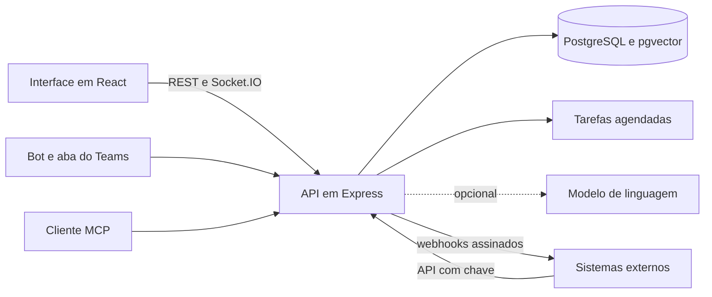

## Tecnologias

**Front:** React 18, TypeScript, Vite, Zustand, TipTap e Yjs, dnd-kit, CSS com tokens.
**Back:** Node 22, Express 5, Prisma, PostgreSQL 16 com pgvector, Socket.IO, Zod.
**Qualidade:** Vitest, Testing Library, Supertest, suíte de integração com banco real, ESLint, GitHub Actions.

## Estrutura

```
backend/   API, regras, tempo real, agentes de IA e migrações
frontend/  interface
docs/      arquitetura, regras de negócio, API pública e marca
manual/    guias de uso por perfil
k6/        teste de carga
```

## Saiba mais

- [Como rodar e testar](docs/desenvolvimento.md)
- [Arquitetura](docs/ARCHITECTURE.md)
- [Regras de negócio](docs/rules): SLA e escalonamento, pendências, vínculos e IA
- [API pública e webhooks](docs/API_INTEGRATION.md)
- [Manual por perfil](manual/README.md)

Os nomes, empresas e números das imagens são fictícios.

## Licença

Código visível apenas para leitura. Todos os direitos reservados: não é permitido usar, copiar ou distribuir sem autorização. Veja [LICENSE](LICENSE).
