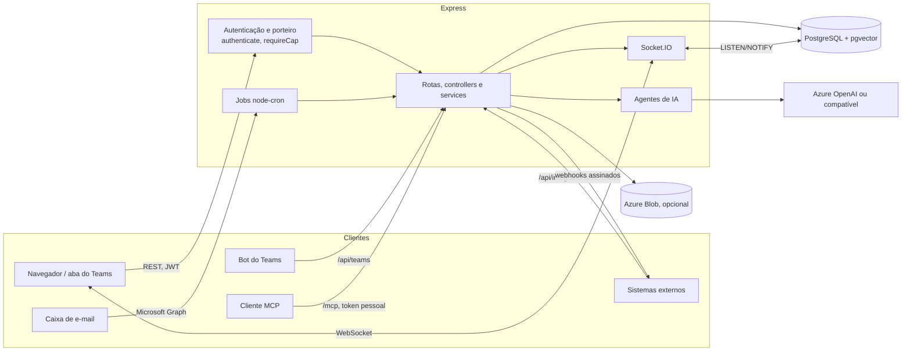

# Arquitetura

O ISA (Integrated Service Atlas) é um sistema de atendimento, projetos e documentos. São dois pacotes independentes: `frontend/` (React + Vite) e `backend/` (Express + Prisma), com PostgreSQL 16 e pgvector.

## Pastas

| Caminho | O que tem |
|---|---|
| `backend/src/routes`, `controllers`, `services` | API REST. A regra de negócio fica nos services |
| `backend/src/access` | Porteiro: catálogo de capacidades, sessão, regras de concessão |
| `backend/src/middlewares` | Autenticação, rate limit, erros, escopo de projeto |
| `backend/src/ai` | Agentes, assistente, base de conhecimento, avaliação offline |
| `backend/src/realtime`, `config/socket.ts` | Socket.IO e edição colaborativa |
| `backend/src/mcp`, `teams/bot` | Servidor MCP e bot do Teams |
| `backend/src/jobs` | Tarefas agendadas |
| `backend/e2e` | Testes de integração com servidor real |
| `frontend/src/access` | Menu lateral, áreas e endereços. Só decide o que mostrar |
| `frontend/src/areas` | Telas de início por perfil, solicitações, Chamados, Gestão, Cadastros e Configurações |
| `frontend/src/pages/projects`, `pages/docs` | Projetos e Documentos |
| `frontend/src/lib` | Tema, animações e editor de documentos |

## Caminho de uma requisição

1. `app.ts` aplica helmet, CORS, parsers e log. Toda a `/api` passa por um limite por usuário (ou por IP, sem token).
2. `authenticate` valida o JWT de acesso (15 min) e confere no banco se a sessão foi revogada. O refresh token fica em cookie httpOnly e é trocado a cada uso.
3. `requireCap('...')` pergunta ao porteiro se a pessoa tem a capacidade.
4. O controller valida a entrada com Zod e chama o service, que confere o acesso ao recurso.
5. O service grava com Prisma, registra auditoria e emite tempo real, notificações e webhooks.
6. `errorHandler` devolve `{ error, code, details? }`.

## Controle de acesso

Quatro perguntas, todas respondidas no servidor:

- **Capacidade** (`access/capabilities.ts`): cada ação tem um nome (`tickets.work`, `sla.manage`…). Vem do cargo ou de uma área liberada na ficha da pessoa. O admin recebe todas, menos atender chamados: ele vê, mas não atua.
- **Módulo** (`services/moduleAccess.ts`): Chamados, Projetos e Documentos ligam e desligam por pessoa, com herança do gerente. Cliente final só usa Chamados.
- **Carteira** (`services/scope.ts`): empresas que a pessoa atende. É a interseção das carteiras da cadeia de chefia; sem nada configurado, nenhuma empresa. Analistas também são filtrados por fila.
- **Papel no recurso**: projeto (dono, gerente, membro, leitor) e espaço de documentos (dono, editor, leitor). Sem acesso, a resposta é 404.

`access/equivalence.test.ts` compara cada rota com um retrato das travas, então mudar quem acessa o quê aparece no teste. O frontend recebe as capacidades na sessão e monta o menu com elas.

## Tempo real

- Socket.IO com autenticação por JWT. Salas por usuário, cargo, fila, chamado, página e espaço.
- Entrar na sala de um chamado exige o mesmo acesso da API. Cada entrega é filtrada por quem pode ver o chamado.
- O adapter do Postgres (`LISTEN/NOTIFY`) leva os eventos entre instâncias, sem Redis.

## Documentos

- Espaços têm páginas em árvore, membros com papel, favoritos, busca, versões, anexos e lixeira.
- O conteúdo é um `Y.Doc` (Yjs) editado com Tiptap. Cada instância mantém as páginas abertas na memória e grava com atraso curto; uma trava por página no banco soma o que outra instância gravou.
- O texto é extraído a cada gravação para a busca. Versões automáticas são criadas durante a edição, com limite de 100 por página.

## Inteligência artificial

| Agente | Onde atua | O que faz |
|---|---|---|
| `knowledge` | Antes de abrir o chamado | Sugere a solução usando só artigos que a pessoa pode ver |
| `triage` | Chamado novo | Sugere ou grava tipo, categoria, subcategoria e prioridade |
| `intake` | Chamado novo | Confere o checklist e pergunta o que falta |
| `guidance` | Chamado novo | Orienta passos seguros e avisa sobre chamado parecido |
| Assistente | Portal, bot do Teams | Conversa, consulta e abre chamados, com confirmação |

- Cada agente tem um modo: desligado, sombra (só registra) ou aplicar. O admin escolhe em Agentes de IA.
- As decisões são perguntas de múltipla escolha com confiança e margem (`ai/core/choice.ts`). Abaixo do limiar, o agente não age.
- Texto enviado ao modelo passa por máscara de dados pessoais (`ai/core/masking.ts`). Saídas passam por filtros.
- Toda execução fica em `ai_agent_runs`, com custo e versão do prompt. `ai/eval` mede os agentes com casos sintéticos.
- O provedor (Azure OpenAI ou qualquer API compatível com OpenAI) é trocado em tela, sem reiniciar.

## Configurações e segredos

- `system_settings` guarda aparência, login Microsoft e provedor de IA. O valor fica em JSON e os segredos em AES-256-GCM (`utils/secretBox.ts`).
- A chave sai de `SETTINGS_ENCRYPTION_KEY` ou, na falta dela, de `JWT_SECRET`. O nome do campo entra como dado autenticado, então um segredo copiado para outro campo não abre.
- Segredos nunca voltam para a tela; a auditoria registra só o nome do que mudou.
- Sem configuração salva, valem as variáveis de ambiente.

## Tema

Três cores (principal, destaque, login) viram todos os tokens, nos modos claro e escuro (`frontend/src/lib/brandTheme.ts`). Os textos são ajustados até 4,5:1 de contraste. O resultado entra num `<style id="brand-theme">`, por cima de `styles/tokens.css`. Os e-mails usam as mesmas cores (`services/appearance.ts`).

## Tarefas agendadas

| Intervalo | Tarefa |
|---|---|
| 1 min | Escalonamento por SLA, leitura da caixa de e-mail, novas tentativas de webhook |
| 5 min | Retorno de pendências agendadas |
| 15 min | Regras de chamado parado, redirecionamento por inatividade, previsão e recorrência de tasks |
| Diário | Limpeza de tokens e entregas, fechamento automático, lixeira |

## Testes

- `backend`: Vitest com banco PostgreSQL real (`isa_test`), um arquivo por vez. `backend/e2e` sobe o servidor e testa por HTTP e WebSocket.
- `frontend`: Vitest com Testing Library.
- `k6/load-test.js` e `prisma/loadtest-seed.ts` fazem o teste de carga.
